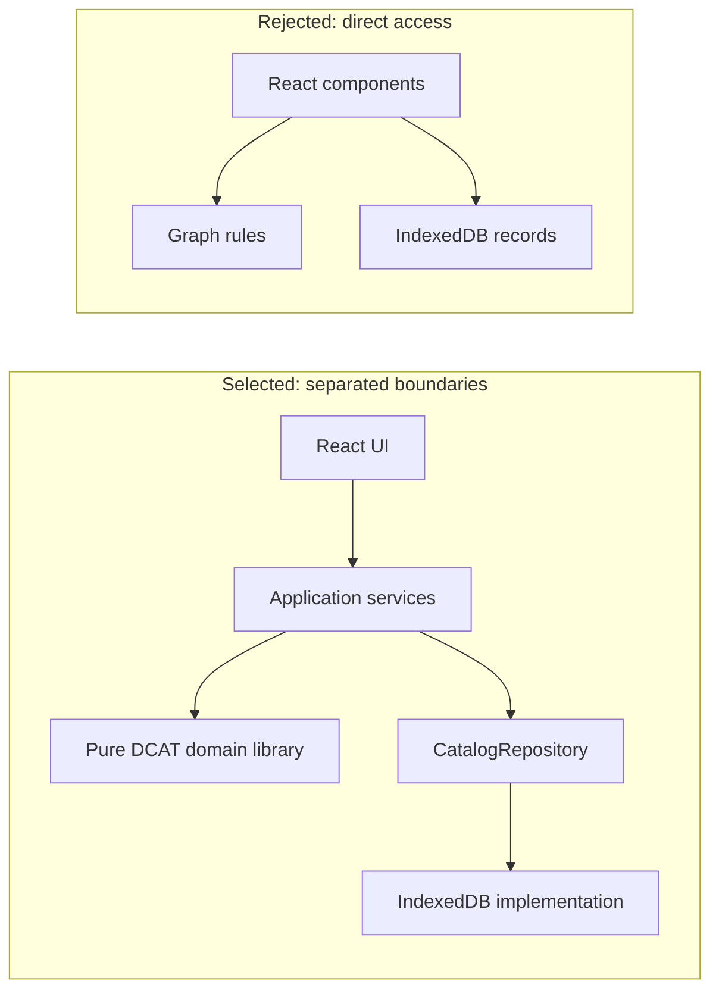

# Implement the phase 1 metadata editor with React, TypeScript, and IndexedDB

## Context and Problem Statement

[ADR 0013](0013-deliver-inventory-in-three-phases.md) establishes phase 1's
product scope: an anonymous browser-only tool for creating, ingesting, editing,
validating, and exporting DCAT-US 3.0 catalogs. This record decides **how to
implement that phase**. It supersedes ADR 0002's proposed server-rendered
Flask/Jinja/HTMX application with one embedded React editor route.

The implementation question is: **which UI, browser persistence, validation
integration, and domain-code boundaries should phase 1 use so it works without an
application backend and does not constrain the phase 2 backend or rendering
architecture?**

## Decision Drivers

- Phase 1 must not require accounts, server persistence, or an application API.
- Catalog work must survive reloads and browser restarts without losing ADR
  0005's object identity, reuse, or relationship ordering.
- Pinned DCAT-US 3.0 schemas drive forms and help text; the Data.gov validator API
  remains the authoritative validation service.
- Section 508 and WCAG 2.1 AA apply to the complete application.
- Measurements with catalogs through at least 3,000 datasets establish and
  disclose the supported browser limit.
- UI and storage details must not enter DCAT graph algorithms that phase 2 may
  reuse.

## Considered Options

The decision combines UI technology, persistence, validation integration, and
code boundaries.

### UI and runtime

| Option | Decisive tradeoff | Assessment |
|---|---|---|
| **React + TypeScript** | Best-supported combination for generated schema forms, independently updating graph-editing panes, editors, virtualized trees, testing, and accessible primitives; the cost is a substantial dependency and build chain | **Preferred** |
| **Vue + TypeScript** | Capable reactive and schema-form ecosystem, but fewer relevant choices than React and no project-specific advantage that offsets changing direction | Viable, not preferred |
| **Angular + TypeScript** | Mature forms and conventions, but more framework surface than this single-purpose application requires | Disproportionate for phase 1 |
| **Svelte + TypeScript** | Lower framework overhead, offset by more custom schema-form, accessibility, and USWDS work | Higher integration risk |
| **Framework-light TypeScript** | Saves framework code but shifts complex state, focus management, and reusable controls into first-party code | Not preferred for this editor |
| **Server-rendered HTML + HTMX** | Requires a backend or a bespoke browser state layer, contrary to phase 1 | Not eligible for phase 1; still possible for later non-editor pages |

USWDS can be used directly with every client framework. Its
[implementations directory](https://designsystem.digital.gov/documentation/implementations/)
lists React options (`@trussworks/react-uswds` and Comet), one Vue option
([`vue-uswds`](https://github.com/patrickcate/vue-uswds)), one Angular option
([`ngx-uswds`](https://github.com/GSA/ngx-uswds)), and no Svelte option. Any
wrapper still requires maintenance, markup, coverage, dependency, and
accessibility review; no wrapper establishes conformance by itself.

### Browser persistence

| Option | Decisive tradeoff |
|---|---|
| **Separate IndexedDB records** | **Selected:** asynchronous structured records, indexes, transactions, targeted graph updates, and reuse lookup |
| **One IndexedDB snapshot per catalog** | Simpler, but small edits rewrite large graphs and independent object lookup is less natural |
| **SQLite/WASM with browser file storage** | Relational constraints, but disproportionate runtime, asset, compatibility, and migration complexity |
| **Memory or user-managed files only** | Cannot provide routine persistence across reloads and restarts |
| **`localStorage`** | Synchronous, capacity-limited string storage without structured indexes or multi-store transactions |

### Code boundaries

- **Pure domain library plus repository interface (selected):** keep DCAT
  operations free of React and IndexedDB and put persistence behind
  `CatalogRepository`.
- **Direct React-to-IndexedDB access:** initially simpler, but couples UI,
  persistence, and graph rules, weakening isolated tests and phase 2 adaptation.

### Validation integration

| Option | Decisive tradeoff | Assessment |
|---|---|---|
| **Browser calls the Data.gov validator API directly** | Preserves ADR 0010's authoritative validation without an Inventory backend, but requires CORS, anonymous access, suitable request limits, and explicit failure handling | **Selected** |
| **Inventory backend proxies validation** | Avoids browser CORS constraints but requires the backend excluded from phase 1 by ADR 0013 | Not eligible for phase 1 |
| **Run authoritative validation in the browser** | Avoids a network dependency but conflicts with ADR 0010's shared-service decision and would execute upstream validation code in Inventory | Rejected |
| **No authoritative phase 1 validation** | Avoids integration work but omits a phase 1 capability required by ADR 0013 | Not eligible |

## Decision Outcome

Implement phase 1 as static assets served by nginx using **React/TypeScript,
USWDS, separate IndexedDB records, and a pure domain library behind a repository
interface**:

- React and TypeScript own the complete phase 1 user interface.
- USWDS supplies the visual and interaction baseline.
- IndexedDB persists ADR 0005's graph as separate records.
- A `CatalogRepository` interface separates editor services from persistence.
- A pure TypeScript domain library owns graph behavior without importing React or
  IndexedDB.
- The browser calls the Data.gov validator API directly for authoritative
  validation; no Inventory backend proxies the request.

There is no Inventory application backend in phase 1. ADR 0013 remains the source
for phase scope.

The selected design's records, lifecycle rules, interactions, flows, deployment
controls, and module boundaries are defined in the system architecture's [data model and persistence
contract](../architecture.md#4-data-model), [create/edit
flow](../architecture.md#51-phase-1-create-ingest-and-edit), [export
flow](../architecture.md#52-phase-1-export-with-success-and-error-reporting),
[static deployment](../architecture.md#phase-1-static-deployment), and [code
organization](../architecture.md#8-code-organization).

### Positive Consequences

- Phase 1 can be deployed as static assets with no account or metadata database.
- Drafts remain in the user's browser except when explicitly sent for validation.
- Separate records support targeted graph edits and reuse lookup.
- The DCAT algorithms are testable without a browser UI or database.

### Negative Consequences

- IndexedDB is tied to one origin and browser profile and is not a backup; users
  need clear loss warnings and downloadable recovery copies.
- Browser storage cannot enforce security or relational integrity against its
  user; phase 1 checks are correctness controls only.
- Direct validation depends on CORS, network availability, request limits, and
  validator capacity.
- The front-end stack adds skills, maintenance, and supply-chain obligations.

### Compliance Consequences

- **SI-10:** bounded parsing, graph checks, and authoritative API validation treat
  imported files and stored records as untrusted and fail visibly.
- **SI-15 / SC-18:** render metadata as text; do not use unsanitized HTML; enforce
  a restrictive Content Security Policy and pin first-party build assets.
- **SR-3:** pin and scan dependencies, commit the lockfile, and review upgrades.
- **CM-2 / CM-3:** pin the schema commit and record application, schema, and
  validator versions in export reports.
- **SA-8 / SA-15:** accessibility, performance, import, and graph-integrity tests
  are release gates.
- Phase 1 has no centralized AU-2/AU-3 audit trail. Local revisions and export
  reports must not be represented as one.

## Blockers before acceptance

1. Demonstrate that the deployed phase 1 browser application can submit a catalog
   directly to the Data.gov validator API without credentials and receive stable,
   machine-readable errors, warnings, paths, and validator/schema versions for
   catalogs up to the supported phase 1 size. Confirm CORS, payload limits,
   timeout and rate-limit behavior, and unavailable-service handling.

## Resolved blockers

1. **Team can maintain the React/TypeScript/IndexedDB application.**
   `cody-seibert-gsa` and `jaredb96` are the primary developers; both have
   React/TypeScript experience, and two experienced developers are backups. The
   team has no current IndexedDB experience, and `sanason` owns learning it.
   Evidence is recorded in
   [GSA/datagov-inventory#8](https://github.com/GSA/datagov-inventory/issues/8).

## Links

- [System architecture](../architecture.md) - detailed phase 1 design and flows
- [ADR 0013](0013-deliver-inventory-in-three-phases.md) - phased delivery
- [ADR 0002](0002-ui-rendering-architecture-for-inventory-v2.md) - superseded hybrid proposal
- [ADR 0005](0005-object-graph-data-model-for-dcat-us-3.md) - shared object graph
- [ADR 0008](0008-onboard-via-data-json-reimport.md) - DCAT-US 3.0 import behavior and phase 2 onboarding
- [ADR 0010](0010-depend-on-upstream-dcat-us-code.md) - schemas and validator API
- [USWDS](https://designsystem.digital.gov/) and [Section 508](https://www.section508.gov/)
- NIST SP 800-53 Rev 5.2 - SI-10, SI-15, SC-18, CM-2, CM-3, SA-8, SA-15, SR-3
